<p align="center">
  
</p>

<h1 align="center">Monkey Civilization</h1>

<p align="center">
  <strong>Commits in. Bananas out.</strong><br>
  A deterministic, contribution-powered pixel-art civilization that lives in your GitHub profile README.
</p>

<p align="center">
  <a href="examples/gallery.html">Age gallery</a> ·
  <a href="#add-it-to-your-repository">Use as an Action</a> ·
  <a href="docs/compatibility.md">GitHub compatibility notes</a> ·
  <a href="#quick-start">Quick start</a> ·
  <a href="#embed-it-in-your-profile-readme">Embed it</a>
</p>

---

Monkey Civilization turns a year of GitHub contributions into a tiny evolving village. Every commit becomes bananas. Bananas feed monkeys, fund buildings, and push the tribe from a campfire to a space elevator. The output is a single self-contained SVG with CSS-only animation: no JavaScript, no external fonts, no backend, and no runtime dependencies.

The simulation is deterministic. The same contribution history always produces exactly the same monkeys, buildings, events, colors, and layout. A GitHub Action can refresh the SVG from the last 365 days of contributions when its workflow runs.

## What is in the box

- **Reusable composite GitHub Action** at the repository root. Consumers use `jihoo12/monkeys@v1` without checking out this code, installing dependencies, or touching their `package.json`.
- **GitHub GraphQL fetcher** with normalized daily contribution data and stats.
- **Deterministic simulation engine**: bananas, population, food, capacity, buildings, upgrades, ages, famines, streaks, and chronicle events.
- **Pixel-art SVG renderer**: a 960×500 scene plus a ~160px HUD inside a 960×660 canvas, 5×7 path-based pixel font, age-specific palettes, 8 building plots with 5 visual tiers each, 14 hand-placed monkey spots, and a compact HUD.
- **CSS-only animation**: walking, bobbing, tail wags, working arms, smoke, fire, clouds, windmills, turbines, Ferris wheels, orbiting bananas, rocket flames, stars, day/night, fireflies, and speech bubbles.
- **Reproducible demos** for five ages: stone, medieval, industrial, modern, and space.
- **Local preview server** that mimics GitHub's light and dark README contexts.
- **Compatibility checker** for the SVG subset that GitHub renders reliably inside ``.
- **Tests** for determinism, simulation invariants, GraphQL parsing, rendering, CLI behavior, compatibility rules, and the action running from a separate consumer workspace.
- **GitHub Actions workflow** that tests, generates, and commits the SVG on code changes or manual dispatch.

## Add it to your repository

No install, no `package.json` changes, no build step. Copy this workflow to `.github/workflows/monkeys.yml`:

```yaml
name: Monkey Civilization

on:
  schedule:
    - cron: '17 3 * * *'
  workflow_dispatch:

permissions:
  contents: write

jobs:
  monkeys:
    runs-on: ubuntu-latest
    steps:
      - uses: actions/checkout@v4
      - uses: jihoo12/monkeys@v1
        with:
          github_token: ${{ secrets.GITHUB_TOKEN }}
          username: ${{ github.repository_owner }}
      - run: |
          git add monkey-civilization.svg
          if git diff --cached --quiet; then exit 0; fi
          git config user.name "monkey-civilization[bot]"
          git config user.email "41898282+github-actions[bot]@users.noreply.github.com"
          git commit -m "chore: refresh monkey civilization"
          git push
```

Then embed the generated file:

```html

```

That is the whole setup. The action runs from its own checkout, installs nothing into your project, and writes the SVG into your workspace. A full example, including the JSON summary, is in [`examples/consumer-workflow.yml`](examples/consumer-workflow.yml).

> Until the maintainer publishes the first release, point `uses:` at `jihoo12/monkeys@main` (or a commit SHA). After release, `@v1` is the stable major tag. See [docs/releasing.md](docs/releasing.md).

### Action inputs

| Input | Required | Default | Meaning |
| --- | --- | --- | --- |
| `github_token` | yes | — | Token for the GraphQL API. Usually `${{ secrets.GITHUB_TOKEN }}`. |
| `username` | no | repository owner | GitHub login to simulate. |
| `output` | no | `monkey-civilization.svg` | SVG path, relative to your workspace. |
| `json_output` | no | empty | Optional JSON summary path. |
| `animate` | no | `true` | Set to `false` for a fully static SVG. |

Outputs: `svg_path`, `json_path`, `age`, `population`, `contributions`, and `buildings`.

> **Token note:** the automatic `GITHUB_TOKEN` works for many public calendars. If GitHub rejects the query, pass a classic PAT with `read:user` instead: `github_token: ${{ secrets.MONKEY_TOKEN }}`. Private contribution counts also require a token that can see those repositories.

See [docs/action.md](docs/action.md) for the full action reference and [docs/releasing.md](docs/releasing.md) for maintainer release steps.

## Quick start

Requirements: Node.js **22.18+** (Node 24 recommended). The project uses Node's native TypeScript type stripping, so there is no build step.

```bash
npm ci
npm run generate:demo
```

That writes `examples/monkey-civilization.svg` from a fixed, reproducible space-age demo history. Open it in a browser, or run the local preview:

```bash
npm run preview
# http://127.0.0.1:4321
```

The preview page loads the SVG through an `` element in both light and dark README-like panes. It also exposes a static fallback and a regenerate button.

To render a PNG for a screenshot:

```bash
npm run render:png
# examples/monkey-civilization.png
```

To regenerate the five-age gallery:

```bash
npm run generate:gallery
# examples/ages/*.svg and examples/gallery.html
```

## Use your real contributions

Create a token that can read your contribution calendar. A classic PAT with `read:user` is enough for public contributions. For private contribution counts, grant the token access to the relevant private repositories.

```bash
cp .env.example .env
# Edit .env:
#   GITHUB_USER=your-login
#   GITHUB_TOKEN=ghp_...
npm run generate -- --user your-login --out monkey-civilization.svg
```

Or pass everything explicitly:

```bash
GITHUB_TOKEN=ghp_... npm run generate -- \
  --user your-login \
  --from 2025-10-27 \
  --to 2026-10-26 \
  --out monkey-civilization.svg \
  --json monkey-civilization.json
```

The CLI prints a summary, runs the compatibility checker, and exits non-zero if the SVG fails a hard compatibility rule.

### CLI options

| Option | Meaning |
| --- | --- |
| `--user`, `-u` | GitHub login. Falls back to `GITHUB_USER`. |
| `--token` | GitHub token. Falls back to `GITHUB_TOKEN`, `GH_TOKEN`, or `MONKEY_TOKEN`. |
| `--demo [profile]` | Use reproducible demo data: `stone`, `medieval`, `industrial`, `modern`, `space`. Defaults to `space`. |
| `--out`, `-o` | Output SVG path. Defaults to `monkey-civilization.svg`. |
| `--from`, `--to` | Inclusive UTC date window. Defaults to the last 365 days ending today. |
| `--json <path>` | Also write a machine-readable summary. |
| `--no-animation` | Emit a static SVG with no keyframes or animation declarations. |
| `--help`, `-h` | Show help. |

## How it works

```text
GitHub GraphQL API
       │
       ▼
src/data/contributions.ts   fetch + normalize 365 daily counts
       │
       ▼
src/sim/engine.ts           deterministic civilization simulation
       │
       ▼
src/render/*                scene, buildings, monkeys, HUD, CSS
       │
       ▼
self-contained SVG          commit / embed in README
```

### 1. Fetch

The fetcher queries `contributionsCollection` for a user and date window, flattens the contribution calendar, fills missing days with zero, and computes totals, active days, streaks, best day, busiest weekday, and weekly buckets.

### 2. Simulate

The engine walks the days in order:

- Each contribution produces bananas. Farms add food. Workshops and wonders add yield bonuses.
- Bananas pay for population growth and building upgrades.
- Population is capped by housing. Food reduces effective upkeep.
- Each of the 8 plots unlocks when the age and population requirements are met, then upgrades one tier per day when affordable.
- Ages advance at fixed contribution thresholds. Each age has a different palette, building set, and yield multiplier.
- Chronicle events record ages, builds, upgrades, streaks, meteor showers, population milestones, famines, and jokes.

### 3. Render

The renderer draws a 960×500 pixel-art scene plus a ~160px HUD inside a 960×660 canvas. Every visible element is an inline SVG shape, path, or group. Text is rendered as vector paths using a tiny 5×7 pixel font, so it does not depend on system fonts. Animation is plain CSS inside the SVG.

### 4. Publish

The SVG is committed by the workflow and embedded with an `` tag. GitHub's image proxy serves it as an image; CSS animations continue to run in browsers that support them.

## Determinism

There is no `Math.random()` and no wall-clock time in the simulation or renderer.

The simulation seed is an FNV-1a hash of:

```text
username + from + to + every "date:count" pair
```

That seed drives the RNG used for monkey colors, accessories, jokes, and scene details. The demo histories also end on a fixed date (`2026-10-26`) so the checked-in examples never drift.

Real-data runs are deterministic **for a given window**. Because the window slides forward each day, the civilization changes when old contributions fall out of the 365-day range.

## Ages

| Age | Contributions | Yield | What changes |
| --- | ---: | ---: | --- |
| Stone | 0 | ×1.00 | Lean-tos, wild banana grove, campfire, torches |
| Medieval | 75 | ×1.15 | Timber cottages, terraced farms, tavern, windmill, bell tower |
| Industrial | 300 | ×1.40 | Brick tenements, agro-industry, town hall, factory, clock tower, coal plant |
| Modern | 800 | ×1.70 | Apartments, vertical farms, civic center, robotics lab, broadcast tower, solar array |
| Space | 1,800 | ×2.20 | Habitat domes, hydroponic domes, space elevator, nano-forge, observatory, orbital banana, fusion reactor, rocket pad |

The HUD shows the current age, level, population, capacity, bananas, daily income, contribution total, active days, and a segmented age-progress bar. The contribution path at the bottom of the scene is a weekly heatmap; age milestones get little flags.

## Commands

| Command | What it does |
| --- | --- |
| `npm run generate:demo` | Generate the space-age example SVG. |
| `npm run generate -- --user <login>` | Generate from real GitHub data. |
| `npm run generate:gallery` | Regenerate all five age SVGs and `examples/gallery.html`. |
| `npm run check:examples` | Regenerate the demo and gallery, then fail if checked-in examples drift. |
| `npm run preview` | Serve the local GitHub-style preview at `127.0.0.1:4321`. |
| `npm test` | Run the Node test suite, including the action tests. |
| `npm run test:action` | Run only the action and consumer-workspace tests. |
| `npm run typecheck` | Run TypeScript in no-emit mode. |
| `npm run check:svg` | Run the compatibility checker on the example SVG. |
| `npm run render:png` | Rasterize the example SVG for screenshots. |

## Embed it in your profile README

Commit the generated SVG to a public repository (this one, or your profile repository), then embed it with an `` tag. Do **not** inline the SVG: GitHub sanitizes inline SVG and strips `<style>` blocks, which would remove the animation.

```html
<p align="center">
  
</p>
```

A Markdown image works too:

```markdown

```

### Cache busting

GitHub's Camo image proxy caches by URL. Updating the SVG changes its file contents but not the URL, so the README can keep showing an old frame. If that happens, append a version query string and update it when you want a refresh:

```html

```

The SVG itself is cache-friendly: it contains no external assets and no network requests.

## GitHub Actions

This section covers the workflow that maintains **this** repository. To generate a civilization in your own repository, use the [reusable action](#add-it-to-your-repository) instead.

The included workflow is [`.github/workflows/monkeys.yml`](.github/workflows/monkeys.yml). It runs on relevant pushes to `main` or `master`, or manually through `workflow_dispatch`. There is no daily schedule. A separate [`.github/workflows/ci.yml`](.github/workflows/ci.yml) runs typechecks, tests, and SVG compatibility checks on pull requests.

It does the following:

1. Checks out the repository and installs Node 24.
2. Runs `npm ci`, the test suite, and the typechecker.
3. Fetches the configured user's last 365 days of contributions.
4. Generates `monkey-civilization.svg` and `monkey-civilization.json`.
5. Runs the compatibility checker.
6. Commits the refreshed files back to the repository if they changed.

### Setup

1. Enable Actions for the repository.
2. Make sure the workflow has `contents: write` permission (already set in the file).
3. Set a repository variable `GITHUB_USER` if the target user is not the repository owner. Otherwise it defaults to `github.repository_owner`.
4. The workflow uses `secrets.MONKEY_TOKEN` when present, and falls back to the automatic `secrets.GITHUB_TOKEN`.

The automatic token may be enough for public contribution calendars. If the GraphQL query is rejected, create a classic PAT with `read:user` and store it as the `MONKEY_TOKEN` secret. For private contributions, the token also needs access to those private repositories.

> If you want the SVG in a different repository from the one running the workflow, either point the workflow's commit step at that repository, or run the workflow in the profile repository itself. The renderer has no server-side state, so any checkout works.

### Keeping the demo fresh

`npm run generate:demo` intentionally uses a frozen end date for reproducible examples. The workflow uses `npm run generate` (real data), not the demo command, so the published SVG follows the live contribution window.

## GitHub compatibility

The generated SVG is designed for the restrictive context of a GitHub README image:

- No `<script>`, `<foreignObject>`, `<iframe>`, `<object>`, `<embed>`, `<audio>`, or `<video>`.
- No external images, fonts, stylesheets, or `href`s.
- No SVG filters.
- No `<text>` elements; all labels are vector paths.
- Inline `<style>` with CSS keyframes only.
- `role="img"`, `<title>`, `<desc>`, and `aria-labelledby` for accessibility.
- A static first frame that is readable even when animation is unavailable.
- `prefers-reduced-motion: reduce` disables animation.

`npm run check:svg` enforces the hard rules and warns about soft risks. See [docs/compatibility.md](docs/compatibility.md) for the full compatibility matrix, known limitations, and troubleshooting.

### Known limitations

- **GitHub mobile apps** and some RSS/email readers show only the static first frame.
- **Camo caching** can delay visible updates; use a `?v=` query string to bust it.
- **Private contributions** only appear if the token can see them and the user's contribution visibility settings allow it.
- **GitHub Actions' default token** may not be allowed to read another user's contribution calendar; use a `read:user` PAT if needed.
- **Animation is progressive enhancement.** The scene is complete without it.
- **The contribution window is 365 days.** Older contributions do not count toward the current civilization.

## Project layout

```text
action.yml                reusable composite GitHub Action
src/
  cli.ts                  command-line entry point
  action.ts               GitHub Action entry point
  generate.ts             shared fetch -> simulate -> render pipeline
  preview.ts              local GitHub-style preview server
  compat.ts               SVG compatibility checker
  types.ts                shared data contracts
  data/
    contributions.ts      GraphQL fetch + normalization + stats
    demo.ts               reproducible demo histories
  sim/
    ages.ts               age thresholds and progress
    catalog.ts            8 plots, building names, costs
    engine.ts             deterministic civilization simulation
  render/
    render.ts             SVG root, gradients, animation CSS, static fallback
    scene.ts              layered sky, mountains, ground, path, monkeys, weather
    buildings.ts          8 plots × 5 age tiers
    hud.ts                framed stat cards, age progress, chronicle ticker
    sprites.ts            monkeys, outfits, tools, icons, speech bubbles
    art.ts                shared pixel-art props: trees, windows, fire, clouds
    pixel-font.ts         path-based 5×7 font
    palette.ts            age-specific color palettes
    svg.ts                small SVG helpers
  util/
    date.ts               UTC date and number helpers
    rng.ts                FNV-1a + mulberry32
scripts/
  generate-gallery.ts     five-age gallery
  render-png.ts           raster preview
  check-svg.ts            compatibility CLI
tests/
  simulation.test.ts      determinism, thresholds, invariants
  contributions.test.ts   GraphQL parsing and stats
  render.test.ts          rendering, static mode, escaping
  compat.test.ts          compatibility rules
  cli.test.ts             end-to-end CLI behavior
  action.test.ts          action contract + separate consumer workspace
examples/
  monkey-civilization.svg animated space-age example
  ages/                   one SVG per age
  gallery.html            browsable age gallery
  consumer-workflow.yml   copy-paste workflow for any repository
docs/
  compatibility.md        GitHub rendering notes
  action.md               reusable action reference
  releasing.md            maintainer release and tag commands
```

## Testing

```bash
npm test
npm run typecheck
npm run check:svg
```

The test suite covers:

- Exact demo totals and the fixed demo window.
- Age boundary values and progress clamping.
- Simulation invariants: population ≤ capacity, non-negative bananas, valid plot states, visible monkeys drawn from the population, 8 plots, astronaut presence in the space age.
- Determinism of both simulation and SVG output.
- GraphQL request shape, day normalization, missing days, level mapping, and error paths.
- Static-mode removal of all animations.
- A rasterized first-frame check that keeps the village visible when CSS animation is ignored.
- Escaping of user-controlled text in SVG metadata.
- Compatibility rejection of scripts, external assets, event handlers, imports, and fonts.
- CLI generation, JSON output, help, static mode, and unknown-option handling.
- The action contract: composite metadata, Node 24, documented inputs/outputs, and no dependency installs.
- A separate consumer workspace: action checkout in one directory, caller repository in another, output paths, GitHub outputs, step summary, token errors, and an untouched `package.json`.

## License

Apache-2.0. See [LICENSE](LICENSE).
